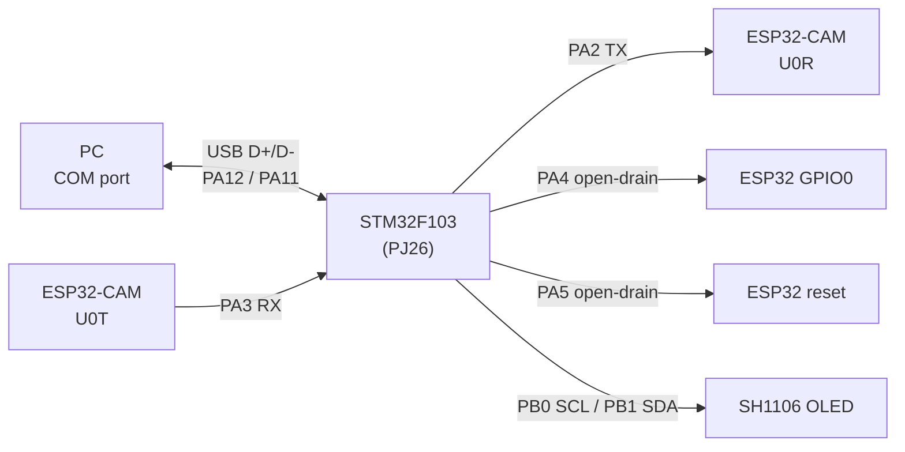

<div align="center">

# PJ26 USB-Serial Adapter

**Turn a spare DX-SMART PJ26 (STM32F103C8T6) into a 3.3 V USB-to-serial adapter that flashes ESP32 boards on its own.**


</div>

No USB-serial chip is used: the STM32 talks USB itself on PA11/PA12 and shows up as an ordinary COM port. DTR and RTS drive the ESP32 boot pins automatically, the baud rate follows your PC, and an optional 1.3" OLED shows what is going on.

> **Honest status.** Confirmed on a real PJ26: the firmware starts, the OLED works, and the PC detects the USB device. Not yet tested on hardware: serial data passing to and from a target, the DTR/RTS boot-pin control, and an actual ESP32-CAM upload. The USB request logic and the I2C screen logic are also tested on a PC.

## Contents
- [Features](#features)
- [How it works](#how-it-works)
- [Pins](#pins)
- [Wiring](#wiring)
- [Quick start](#quick-start)
- [Build](#build)
- [Flash the adapter](#flash-the-adapter)
- [Using it](#using-it)
- [OLED status screen](#oled-status-screen)
- [Diagnostic firmware](#diagnostic-firmware)
- [Limits](#limits)
- [Troubleshooting](#troubleshooting)
- [Repository layout](#repository-layout)
- [Tests](#tests)
- [Credits and licence](#credits-and-licence)

## Features
- Native USB full-speed **CDC-ACM** serial port (no CH340 involved).
- **Automatic ESP32 boot mode**: DTR and RTS drive GPIO0 and reset with the classic auto-program truth table, so esptool and the Arduino IDE work hands-off.
- **Baud rate follows the PC** (1200 to 2,000,000 requested; keep it at or below 460800).
- **1.3" SH1106 OLED** status screen: USB state, baud, DTR/RTS, boot-pin lines, byte counters, and start-up failure messages.
- About 6.5 KB, no libraries, no HAL. Built with clang and lld.
- Uses only the pins **PA2, PA3, PA4, PA5, PA11, PA12, PB0, PB1, PB11 and 3V3**.

## How it works


DTR and RTS from the PC map to the ESP32 pins like this (the circuit esptool expects):

| PC lines | PA4 (ESP32 GPIO0) | PA5 (ESP32 reset) | Purpose |
|---|---|---|---|
| RTS only | released | pulled **low** | reset the chip |
| DTR only | pulled **low** | released | boot loader mode |
| both, or neither | released | released | run |

PA4 and PA5 are open-drain: they only ever pull low or let go, never drive high.

## Pins
| Pin | Function | Direction | Notes |
|---|---|---|---|
| PA11 | USB D- | PC to board | USB cable D- |
| PA12 | USB D+ | PC to board | USB cable D+, **plus a 1.5 kΩ resistor to 3V3** |
| PA2 | USART2 TX | out | To the target's RX (ESP32-CAM U0R, GPIO3) |
| PA3 | USART2 RX | in | From the target's TX (ESP32-CAM U0T, GPIO1). 3.3 V only |
| PA4 | Boot control | open-drain out | ESP32 GPIO0 |
| PA5 | Reset control | open-drain out | ESP32 reset (optional wire) |
| PB0 | OLED SCL | open-drain out | Bit-banged I2C, module pull-ups |
| PB1 | OLED SDA | open-drain I/O | |
| PB11 | Status LED | out | The PJ26's blue LED, lit while bytes pass |
| 3V3 / GND | OLED power, common ground | | |

> PA2 to PA5 and PB0/PB1 are **not 5 V tolerant**. Never connect a 5 V signal to them.

## Wiring
```
 USB cable                 PJ26 (adapter)                 ESP32-CAM
 D-  ------------------->  PA11
 D+  ---+--------------->  PA12
        |
      1.5k to 3V3                      (about 1.2k to 2.2k also works;
                                        two resistors in parallel are fine)
 GND ------------------->  GND  ---------------------->  GND
                           PA2  ---------------------->  U0R (GPIO3)
                           PA3  <----------------------  U0T (GPIO1)
                           PA4  ---------------------->  GPIO0
                           PA5  ---------------------->  reset button pad (optional)
                                                         5V  <- its own 5 V supply
 OLED:  VCC=3V3   GND   SCL=PB0   SDA=PB1
```

- **The 1.5 kΩ resistor** goes between PA12 and 3V3. It is a side branch: the D+ wire runs straight to PA12, one resistor leg joins at PA12, the other leg goes to 3V3. It is what tells the PC a USB device is present; without it nothing is detected.
- **USB-C breakout orientation:** most breakouts connect only one of the plug's two D+/D- pairs. If nothing is detected, flip the plug over.
- **Power the adapter** from its own USB-C (the CH340 stays unused), and leave the data cable's VBUS unconnected so two supplies do not meet. Alternatively feed 5 V from the data cable into the board's 5V pad and leave the USB-C empty. Do not use both.
- **Power the ESP32-CAM** from its own 5 V source with a common ground. Its Wi-Fi bursts are too much for the PJ26's 3.3 V regulator. Add 470 to 1000 µF at its 5 V pin.
- **Reset wire:** the AI-Thinker ESP32-CAM has no EN pin on its headers. For hands-off uploads, solder a wire from PA5 to one pad of the cam's reset button. Without it, press the reset button by hand when the upload starts.

## Quick start
1. Build or take the prebuilt file from [`firmware/prebuilt/`](firmware/prebuilt/).
2. [Flash](#flash-the-adapter) `pj26_usb_native.hex` to the PJ26.
3. Wire it as above, plug the data cable into the PC.
4. The OLED should show `BOOT OK`, then `CLOCK 72MHZ OK`, then `USB: ...`.
5. A new serial port appears. Use it as in [Using it](#using-it).

## Build
Requires **clang**, **ld.lld** and **llvm-objcopy** (built here with LLVM 18). No STM32 libraries, HAL or CubeIDE.

```sh
cd firmware
./build.sh
```
Produces `pj26_usb_native.elf/.bin/.hex` (about 6.5 KB) and copies the `.bin` and `.hex` to `firmware/prebuilt/`. The environment variables `CC`, `LD` and `OBJCOPY` override the tools.

On Windows use WSL or an LLVM install and run the commands from `build.sh` by hand.

Arm GNU toolchain alternative (not tried here):
```sh
arm-none-eabi-gcc -mcpu=cortex-m3 -mthumb -Os -ffreestanding -nostdlib -fno-builtin -Wl,-T,link.ld \
    start.c main.c usb_proto.c oled.c -o pj26_usb_native.elf
arm-none-eabi-objcopy -O binary pj26_usb_native.elf pj26_usb_native.bin
```

## Flash the adapter
These steps use **MCUISP** (also sold as **FlyMcu**, by the same author; the options are the same), a Windows tool that loads a `.hex` file through the PJ26's own USB-C port. No ST-Link is needed. The USB-C goes to the on-board CH340 chip, which talks to the STM32's built-in boot loader.

> Option names below are as shown in the common English builds of MCUISP/FlyMcu. Your version may word them slightly differently.

### What you need
- the PJ26 with its own USB-C cable (a **data** cable)
- `firmware/prebuilt/pj26_usb_native.hex` (or `diagnostic/prebuilt/pj26_diag.hex` for the diagnostic)
- MCUISP or FlyMcu (Windows 10 and later install the CH340 driver by themselves)

### 1. Connect
Leave the BOOT0 jumper where it is. You never need to move it. Take off anything wired to **PA9 or PA10** (the boot loader uses them). Plug the USB-C into the PC. The red power LED lights, and the board appears in the flashing app as a connectable port.

### 2. Set up MCUISP
1. Start MCUISP and select the PJ26 in the serial-port box.
2. Set the speed (bps) to **115200**. If you get errors later, drop to 57600.
3. Click the file button next to *Online ISP code file* and select `pj26_usb_native.hex`. For a `.hex` file the address comes from the file. (For a `.bin` file you would enter the start address `0x08000000`.)
4. Tick **Verify**.
5. Tick **Run after ISP complete** so the program starts straight away.
6. **Leave "Program OptionBytes" unticked**, and do not set any read-protection option. Read protection locks the chip and makes it hard to reflash.

### 3. Program
1. Click **Start ISP**. The log shows **waiting**.
2. While it says waiting, press the **reset button** on the board. Flashing starts.
3. Watch the log. It connects, erases, writes with a progress percentage, and verifies. A good run ends with a line like `Verify checksum OK` and the start address `08000000`.
4. A warning such as **"RDP did not enable, the chip isn't read protect"** is harmless: it only says the chip is not read-protected, which is what you want.

### 4. Run the program
1. When the flash finishes, unplug the USB-C and plug it back in. The new firmware runs.
2. The OLED should show `PJ26 USB-SERIAL`, then `BOOT OK`, then `CLOCK 72MHZ OK`. No screen? Flash `pj26_diag.hex` the same way to test the chip and screen.
3. Rewire PA9/PA10 if you removed anything from them.

### If it goes wrong
| Problem | Check |
|---|---|
| MCUISP cannot connect, or times out | The PJ26 is selected in the port box; nothing else (Arduino serial monitor, another terminal) has the port open; the cable carries data; click Start ISP, then press the board's reset button while the log says waiting |
| Errors partway through writing | Lower the speed to 57600; use a shorter cable or a port directly on the PC |
| Reports success but nothing happens | Unplug and replug for a full power-up; make sure Verify passed |
| The old firmware still runs | Replug after programming; make sure Verify passed |
| The chip seems locked or protected | Do not use any read-protect option. Use a tool's "unprotect" or "erase chip" option, then reflash |

### With an ST-Link instead
Flash the `.hex` with STM32CubeProgrammer (SWD: 3V3, GND, PA13 SWDIO, PA14 SWCLK), or `st-flash write pj26_usb_native.bin 0x8000000`. PA13/PA14 are not used by this firmware, so the ST-Link keeps working.

## Using it
**1. Flash an ESP32-CAM from the Arduino IDE.** Board *AI Thinker ESP32-CAM*, select the new COM port, Upload Speed **460800 or lower**, press Upload. With the PA5 wire it is hands-off; otherwise press the cam's reset when the IDE says "Connecting...". Press reset again afterwards to run the sketch.

**2. Flash with esptool.**
```sh
esptool.py --chip esp32 --port COM5 --baud 460800 write_flash 0x10000 firmware.bin
```
(`/dev/ttyACM0` on Linux.)

**3. Talk to the cam by hand.** Open a terminal on the port at 115200 8N1 with CR+LF line endings and type AT commands (`AT`, `AT+CWLAP`, `AT+SDINFO`).

**4. Listen in on a link.** Connect only GND and PA3 (leave PA2 free) to a 3.3 V serial line to watch its traffic, for example the main board's link to the cam.

**5. General 3.3 V serial console** for ESP modules, GPS, sensors or another microcontroller's debug port (8N1 only).

### Everything it can flash or talk to
Anything with a **3.3 V UART that needs 8 data bits, no parity, 1 stop bit, at 460800 baud or lower**. The "Limits" section lists what is left out.

| Device or family | How | Notes |
|---|---|---|
| **ESP32-CAM (AI Thinker)** | Arduino IDE or `esptool` | Hands-off with PA4 to GPIO0 and PA5 to EN; otherwise hold the boot button / tap reset by hand. The main use of this adapter. |
| **ESP32 boards** (DevKit, WROOM, WROVER, S2, S3, C3 and similar with GPIO0 and EN) | Arduino IDE, `esptool`, ESP-IDF, PlatformIO | Same wiring. Boards with their own USB port don't need it, but it works. |
| **ESP8266** (ESP-01, NodeMCU, Wemos D1 mini, ESP-12) | Arduino IDE, `esptool` | GPIO0 low to flash, so the PA4 wiring works the same way. Use 460800 or lower. |
| **ESP-AT modules** | Terminal at 115200 8N1 | Send AT commands; also flash new AT firmware with `esptool`. |
| **Arduino-style AVR boards with a serial boot loader** (Uno, Nano, Pro Mini, Mega) | Arduino IDE, `avrdude` | The 8N1 link is fine, but there is **no auto-reset**: press reset as the upload starts. 3.3 V boards only, or use a level shifter for 5 V ones. |
| **ATtiny / ATmega with a UART boot loader** (Optiboot, Urboot, MiniCore) | `avrdude` | Same as above. |
| **RP2040 / Raspberry Pi Pico** | Not needed | They flash over their own USB. The adapter is useful only as a serial console on their UART pins. |
| **Other 3.3 V microcontrollers with an 8N1 serial boot loader** (for example NXP LPC and many Cortex-M boards using their vendor ISP tool) | The vendor tool or its command-line program | Works if the boot loader is plain 8N1. Check its datasheet. This part is not tested here. |
| **Serial consoles and debug ports** | Any terminal (PuTTY, Tera Term, `screen`, Arduino Serial Monitor) | Routers, Linux boards (Raspberry Pi, Orange Pi, BeagleBone), SBCs, 3D-printer boards, other STM32 or ESP debug UARTs. |
| **GPS, GSM, Bluetooth and Wi-Fi modules, sensors** | Terminal or the vendor's config tool | 3.3 V, no hardware flow control. |
| **Staplez Studio OS main board link** | Listen-in connection | Watch the traffic between the PJ26 and the ESP32-CAM. |

Only the first rows have been designed and checked against this firmware. The others should work because they only need a plain 8N1 UART, but they have not been tried on the real adapter.

## OLED status screen
Optional 1.3" **SH1106 128x64 I2C** module (address 0x3C) on PB0/PB1. If none answers, the adapter runs without it.

```
PJ26 USB-SERIAL
USB: READY          WAITING FOR PC / CONNECTING / READY / PORT OPEN
BAUD: 115200
DTR:0 RTS:0
IO0:HIGH EN:RUN     IO0:LOW / EN:RESET while the PC asks for boot or reset
PC>CAM 12345        bytes sent from the PC
CAM>PC 6789         bytes received from the target
D+:1 D-:0 R:1 S:5230  the two USB lines, bus resets seen, frames seen
```

The screen starts first, before the 72 MHz clock, so start-up problems appear on it:

| Screen shows | Meaning |
|---|---|
| nothing at all | not running this firmware, or the screen is wired wrong: run the [diagnostic](#diagnostic-firmware) |
| `BOOT OK`, then `CLOCK 72MHZ OK` | healthy start; `USB: ...` follows |
| `FAIL: NO CRYSTAL` | the 8 MHz crystal did not start (USB cannot work without it) |
| `FAIL: PLL NO LOCK` or `FAIL: CLOCK SWITCH` | the clock multiplier failed |
| stuck on `CLOCK 72MHZ OK` | the program stopped in the USB set-up |

**USB packet counters (debug build, `USB_DEBUG 1` in `main.c`).** Lines 4 and 5 then show `SU:a TX:b ER:c` and `RQ:` plus the first 8 bytes of the last setup request:
| Reading | Meaning |
|---|---|
| `SU:0` after a reset | the chip never received the PC's first request: wiring, clock or USB-C plug orientation |
| `SU:n`, `TX:0` | requests arrive but the replies are not completing: firmware bug |
| `ER` counting up | signal errors on D+/D-: bad contact, wires too long, or the clock is off |
| `RQ:80060001...` | the PC asked for the device descriptor (normal first request) |
`USB_DEBUG` is 0 by default, which shows the DTR/RTS and boot-pin lines; set it to 1 for these counters.

**Last line (USB debug):** `D+:x D-:y R:n S:n`
| Reading | Meaning |
|---|---|
| `D+:1 D-:0`, `R` and `S` count up | connected and talking: the USB link works |
| `D+:1 D-:0` but `R:0 S:0` | the idle level is right but the PC never sends a reset: PC port not detecting (try another cable/port) |
| `D+:0 D-:0` | no signal at all: D+/D- wires, ground, or the PC end is not connected |
| `D+:0 D-:1` | D+ and D- swapped, or the 1.5 kΩ resistor is on D- |
| `D+:1 D-:1` | both lines high: shorted together, or floating |

## Diagnostic firmware
[`diagnostic/`](diagnostic/) is a 2.3 KB test that needs no USB and no crystal. It proves the chip runs code (3 fast blinks of the blue LED) and tests a 128x64 I2C OLED on two pin pairs, reporting by blinks and by lighting the screen fully white, then showing text.

| Pair | SCL | SDA |
|---|---|---|
| A (this adapter) | PB0 | PB1 |
| B (the Staplez OS main firmware) | PB8 | PB9 |

Slow blinks per group: **1** = display at 0x3C, **2** = display at 0x3D, **3** = nothing answered, **4** = SCL stuck low, **5** = SDA stuck low. The pair that is not wired reads 3, 4 or 5: ignore it.

```sh
cd diagnostic && ./build.sh
```

## Limits
This is a plain USB-to-serial (CDC) adapter with one 3.3 V UART and two control lines. A ready-made CH340, CP2102 or FT232 adapter does a few things this one does not. This is everything it **cannot** flash or talk to that a normal adapter usually can.

### Devices and jobs it can't do
| What you want to do | Why it fails here |
|---|---|
| Flash an **STM32** (or **GD32**) through its ROM boot loader: MCUISP, FlyMcu, STM32CubeProgrammer (UART), `stm32flash` | The boot loader needs **even parity (8E1)**. This firmware always runs 8N1 and ignores the parity the PC asks for. Use an ST-Link, or a normal CH340/CP2102/FT232 adapter. |
| Flash anything else whose boot loader needs **parity, 7 data bits or 9 data bits** | Same reason: only 8 data bits, no parity. |
| Flash an **Arduino Uno / Nano / Pro Mini / Mega** (AVR with auto-reset on DTR) | DTR here pulls the **IO0 (boot) pin**, not a reset line, so the board will not reset by itself. Press its reset button just as the upload starts. |
| Flash an **ESP8266 / ESP32** at **921600 baud or faster** | Limit is **460800**. Pick 460800 or lower in the Arduino IDE or `esptool`. |
| Flash an **ESP8266 / ESP32** whose EN and GPIO0 are not wired to PA5 / PA4 | Auto-reset only works through those two pins. Otherwise hold BOOT and tap reset by hand. |
| Use a device that needs **RTS/CTS flow control** (some Bluetooth and Wi-Fi modules, modems, fast data loggers) | No hardware flow control. RTS and DTR are used as the boot and reset outputs. |
| Use a device that needs a **break signal** or **2 stop bits** (DMX512, LIN, some industrial and lab gear) | Break is not sent, and stop bits are ignored (always 1). |
| Flash or program over **SPI, I2C, JTAG or SWD**: SPI flash chips (the CH341A kind), AVR ISP, FT232H / FT2232 MPSSE programmers, J-Link | It is a UART only. There is no MPSSE or bit-bang mode. |
| Use **FTDI-only or CH340-only tools** that look for those chips: FT_PROG, D2XX / bit-bang apps, CP210x configuration tools | The PC sees a generic CDC serial port with ID 1209:0001, not an FTDI, Silicon Labs or WCH chip. |
| Connect to a **5 V** target (Arduino Uno, many sensors) | 3.3 V logic only. Use a level shifter. |
| Connect to **RS-232** (±12 V) or **RS-485** | Needs an external transceiver. There is no direction-control pin for RS-485. |
| Talk to **two serial devices** at once | Only one UART (USART2, PA2/PA3) is used. |

### Other limits
- Polled, no DMA: keep the baud at or below **460800**. Higher rates are not tested.
- The adapter needs the 8 MHz crystal and the 1.5 kΩ resistor on PA12. There is no internal-oscillator fallback, because USB needs an accurate clock.
- USB IDs are VID 0x1209 / PID 0x0001 (the pid.codes test pair): fine for personal use, not for a product.
- Passing data through to a target and the DTR/RTS pin control are covered by the PC tests but have not yet been proven on a real ESP32-CAM. Test it on your own board before relying on it.

## Troubleshooting
| Symptom | Check |
|---|---|
| Works only one way round | A USB-C breakout usually wires only one of the plug's two D+/D- pairs, so the cable must be plugged in the right orientation. If the screen shows `USB: CONNECTING` and never `READY`, flip the plug |
| The PC does not see any new device | 1.5 kΩ from PA12 to 3V3; D+ and D- not swapped; a data cable (not charge-only); the screen says `CLOCK 72MHZ OK` |
| "Unknown device" or no COM port | Windows 10 and later load the serial driver automatically; Windows 7/8 need a CDC driver |
| Upload fails at "Connecting..." | PA2 to U0R and PA3 to U0T (crossed); common ground; press the cam's reset by hand if PA5 is not wired; GPIO0 low during the upload |
| Garbage characters | Baud mismatch |
| The cam resets during upload | Cam not on its own 5 V supply; add 470 to 1000 µF at its 5 V pin |
| OLED blank | Run the diagnostic; check address 0x3C, SCL on PB0, SDA on PB1, VCC on 3V3, and that GND is a real ground |

## Repository layout
```
firmware/          the adapter
  main.c             clock, pins, USB endpoints, byte pumping, status screen
  usb_proto.c/.h     USB descriptors, control requests, DTR/RTS to ESP pin mapping (hardware independent)
  oled.c/.h          SH1106 text driver (bit-banged I2C)
  font5x7.h          font
  start.c, link.ld   vector table, reset handler, linker script (64 KB flash, 20 KB RAM)
  build.sh           build script
  prebuilt/          .bin and .hex
diagnostic/        LED and OLED test firmware, with its own build.sh and prebuilt files
tests/             PC test of the USB protocol layer
```

## Tests
Both run on a PC with gcc and no hardware:
```sh
cd tests && gcc -Wall -I../firmware -o usb_test usb_test.c ../firmware/usb_proto.c && ./usb_test     # 19 checks
cd diagnostic && gcc -w -o diag_test diag_test.c && ./diag_test                                      # 8 checks
```
The first covers descriptors, SET_ADDRESS, line coding and the DTR/RTS truth table. The second runs the diagnostic's real I2C code on a PC against a software model of the display. Neither replaces testing on the board.

## Credits and licence
Copyright (c) 2026 **Staplez Studio**.

**Free for personal, non-commercial use. Commercial use needs a licence: contact Staplez Studio first.** Full terms in [LICENSE.md](LICENSE.md).

All original source code, screen layouts, bitmaps and artwork in this repository are the work of Staplez Studio, except where listed below.

### Third-party credits
| Who | What |
|---|---|
| STMicroelectronics | RM0008 reference manual and STM32F103 datasheet: register definitions used by the firmware. The USB endpoint-register handling follows the technique of ST's USB-FS-Device library (re-written, no code copied). |
| USB Implementers Forum | USB 2.0 and CDC/PSTN class specifications, followed by the descriptors and requests. |
| Espressif | The DTR/RTS auto-reset convention used by esptool and the ESP32 development boards. |
| Solomon Systech / Sino Wealth | SH1106 OLED controller datasheet: the start-up command sequence. |
| pid.codes | USB ID 1209:0001, their test pair. For testing only: get your own ID before making a product. |
| LLVM Project | clang and lld, used to build the firmware (not distributed). |

### To confirm
- `font5x7.h` and `diagnostic/font5x7.h`: a 5x7 ASCII font table supplied with the project. Staplez Studio to confirm its origin before publishing.
